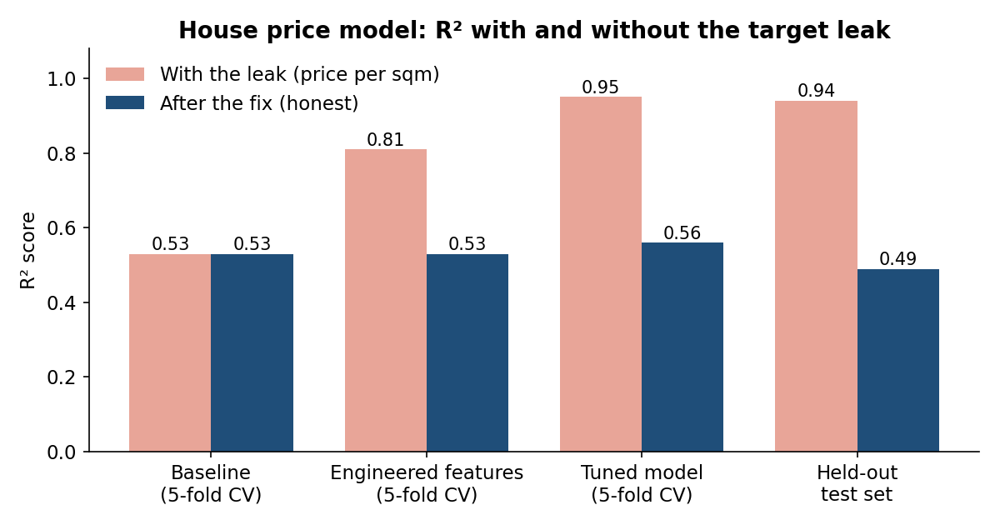
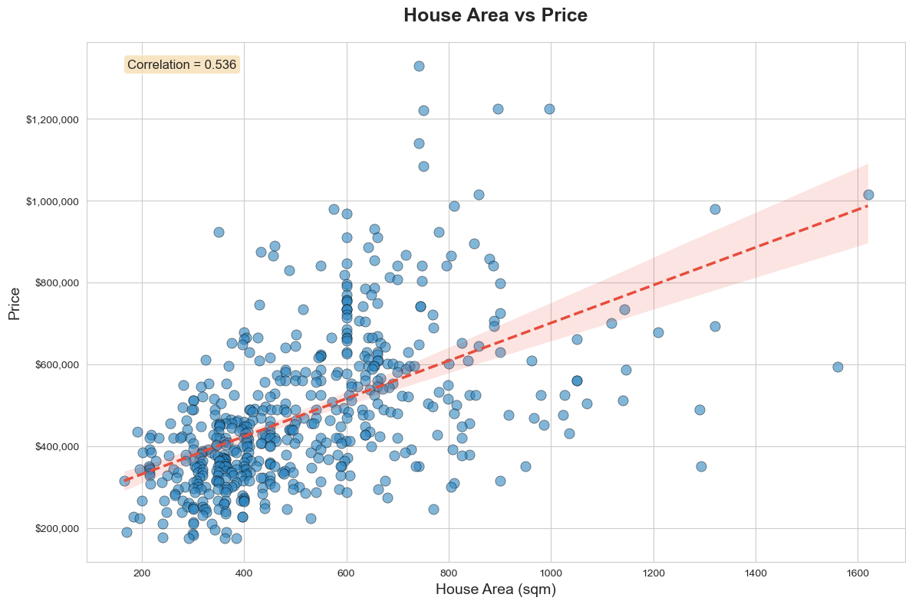

# House Price Prediction

Predicting house sale prices from basic listing details with scikit-learn, and what I learned from finding and fixing **target leakage** in my own model.

## The problem

The dataset has 545 houses across five US cities, with floor area, bedrooms, toilets, stories, renovation status, city and sale price. The goal is a regression model that predicts price from the other columns.

## Approach

1. **Exploratory data analysis:** price against each feature, and correlations, to see what drives price.
2. **Target transform:** modelled `log(1 + price)` because prices are right-skewed, then converted predictions back to dollars for evaluation.
3. **Leak-free preprocessing:** split train and test first, then one-hot encoded city and renovation status and standardised the numeric columns using the training set only.
4. **Model comparison:** Linear, Ridge and Lasso regression and Random Forest, with 5-fold cross-validation.
5. **Feature engineering:** total rooms (bedrooms + toilets) and area per story.
6. **Hyperparameter tuning:** randomized search on the Random Forest, then a final evaluation on the held-out test set.

## The leak I found and fixed

My first version also created **price per square metre**, calculated as `price ÷ area`. That feature is computed from the price itself, so the model could multiply it by the area and get the answer back. It looked like a big win:

| Stage | With the leak | After the fix |
|---|---|---|
| Baseline, 5-fold CV (best model) | R² 0.53 | R² 0.53 |
| After feature engineering, 5-fold CV | R² 0.81 | R² 0.53 |
| Tuned Random Forest, 5-fold CV | R² 0.95 | R² 0.56 |
| **Held-out test set** | R² 0.94, RMSE ≈ $55k | **R² 0.49, RMSE ≈ $160k** |



The rule I now use: *could I calculate this feature for a new house before knowing its price?* Price per square metre fails that test, so I removed it. Every improvement after the baseline had come from the leak.

## Results

The honest model explains about half of the variation in price (test R² 0.49). Floor area is the strongest single signal, but even it only has a 0.54 correlation with price, and houses of the same size sell for very different amounts:



With only 545 houses and six basic columns, much of what sets a house's price, such as exact location, age, condition and lot size, simply isn't in the data.

## What I learned

- A score that jumps suddenly deserves suspicion, not celebration. Check every engineered feature against the target.
- Splitting before any preprocessing, and fitting encoders and scalers on the training set only, keeps the test set honest.
- A lower, real number is worth more than a high one that falls apart when someone reads the code.

## What I'd improve

- Add features that actually carry price information, such as location detail, house age or lot size, if a richer dataset is available.
- Try gradient boosting and compare it against the regularised linear models, which performed almost as well as the Random Forest.
- Plot residuals by city and price range to see where the model is weakest.

## Run it

```bash
pip install -r requirements.txt
jupyter notebook house_price_prediction.ipynb
```

The notebook keeps its outputs, so you can read the charts and results without running it.

## Data

`data/housing_price_data.csv` holds 545 house sales across five US cities: New York, Seattle, Boston, Denver and Chicago.
